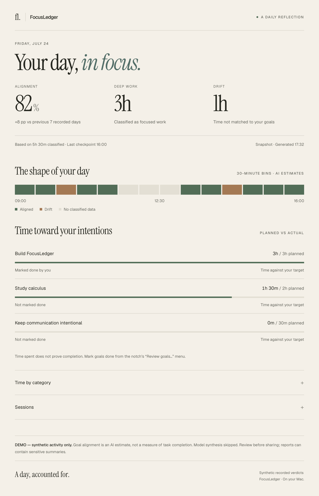

<div align="center">
<h1>FocusLedger</h1>
<p>Did your day match your goals? Reflect on your Mac activity with local AI.</p>
<p><strong>Public alpha · macOS · Python 3.12 · MIT</strong></p>

</div>

Set goals before working. FocusLedger reads your active window with Apple Vision,
asks Gemma through local Ollama to estimate alignment, and creates an HTML report
when you choose **View report** or **End day**. Reports are on demand, not scheduled.

This is a source-based alpha, originally built at a hackathon. It is intended for
personal reflection. AI judgments can be wrong; scores and derived cognitive
metrics are experimental estimates, not validated performance measurements.

## Quick start

Initial support target: **Apple Silicon, macOS 26 or later, Python 3.12**.
Native capture/OCR and local-model integration verified on macOS 27.2.
Other hardware and OS versions are unverified. Install Python 3.12 and
[Ollama](https://ollama.com/download) first. Voice input additionally needs Xcode
Command Line Tools (`xcode-select --install`); typed goals work without voice.

```bash
git clone https://github.com/Aaryan1524/FocusLedger.git
cd FocusLedger
./start.sh
```

The launcher installs dependencies, builds local app launchers, and opens setup.
Select a model, download it explicitly, and allow Screen Recording for Python in
System Settings. Quit and reopen after granting permission. Enter goals, click
**Start day**, work, then choose **End day**. **View report** requests a checkpoint
while tracking continues. First inference can take several minutes.

The `.app` is a repository launcher: keep it with the checkout. It is locally
ad-hoc signed, not a standalone notarized download.

## Try without recording your screen

After installing dependencies:

```bash
./start.sh --demo-report
```

This renders the committed synthetic sample without contacting Ollama, reading
personal history, or launching tracking. The output is visibly marked as a demo.
See [setup and troubleshooting](docs/setup.md) for the developer command.

## Privacy and storage

- Capture targets one identified visible window of the frontmost application;
  unavailable or blocked windows are skipped. There is no full-screen fallback.
- Screenshot pixels stay in memory. OCR text is buffered in memory for local
  classification; generated summaries and goals persist in your activity ledger.
- Default data location: `~/Library/Application Support/FocusLedger/`.
  Reports and summaries can contain sensitive information. Review before sharing.
- Inference requests use `localhost:11434`. Installing dependencies, downloading
  models, and opening help links require network access.
- Application/title blocklists are best effort. They cannot recognize every
  sensitive page, and JSON constraints do not eliminate prompt injection.

Read the [privacy and data guide](docs/privacy.md) before tracking sensitive work.

## Models and controls

Choose Light (`gemma3:1b`), Balanced (`gemma3:4b`), or Best (`gemma3:12b`) in setup.
The RAM-based default and model preference are shared across processes. Smaller
models are faster and can misclassify; larger models need more memory and time.
`FL_MODEL=gemma3:4b ./start.sh` overrides the saved choice for one launch.

The menu provides setup, sample goals, demo report, new day, and quit.
`./start.sh --quick` uses one-minute checkpoints; regular tracking uses 30 minutes.
Idle periods close sessions. At midnight tracking ends; start a new day with fresh
goals. **New day** preserves history and requires ending active tracking first.

## Contribute

```bash
make dev
make check
make demo
```

Start with [CONTRIBUTING.md](CONTRIBUTING.md), the [architecture](docs/architecture.md),
and the [roadmap](docs/roadmap.md). Tests mock model and capture calls; no screen
permission or model download is needed. Native tests require macOS.

- [Support](SUPPORT.md) · [Security](SECURITY.md) · [Code of conduct](CODE_OF_CONDUCT.md)
- [Release checklist](docs/releasing.md) · [Changelog](CHANGELOG.md) · [MIT license](LICENSE)

Repository workflow takes inspiration from
[Microsoft HVE Core](https://github.com/microsoft/hve-core), particularly explicit
validation and contributor onboarding. FocusLedger does not depend on HVE Core.
